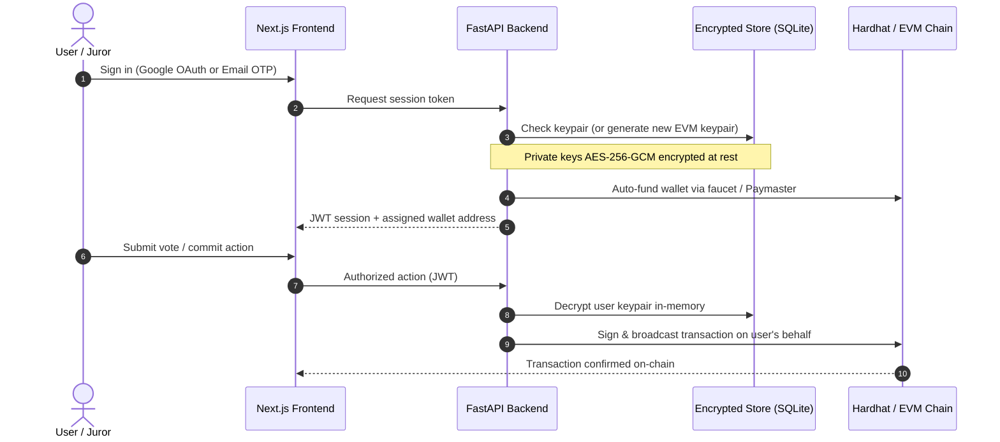
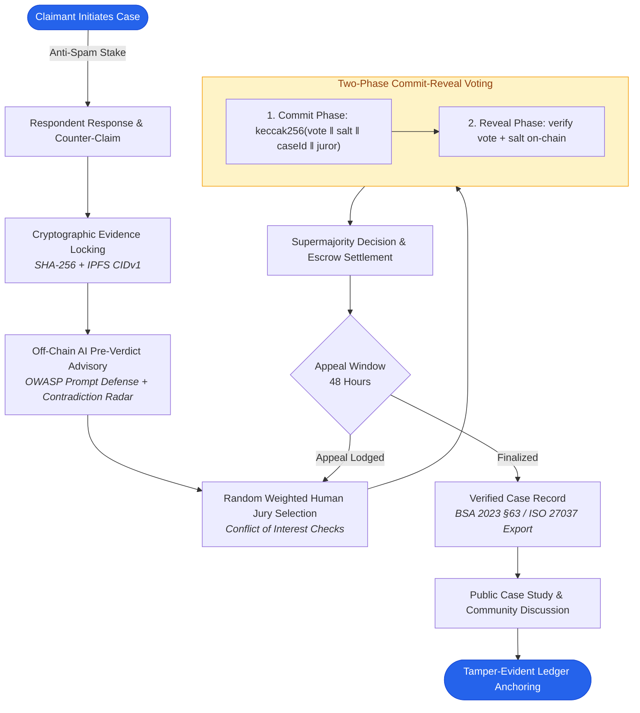

<div align="center">

# ⚖️ Resolvia
### AI-Assisted Decentralized Dispute Arbitration Platform

> **Auditable by design. Private by default. Decided by humans.**

[](https://opensource.org/licenses/MIT)
[-black?logo=next.js)](https://nextjs.org/)
[](https://fastapi.tiangolo.com/)
[](https://soliditylang.org/)
[](https://python.org/)
[](https://nodejs.org/)

Resolvia unifies artificial intelligence, blockchain smart contracts, content-addressed storage (IPFS), and modern web architecture to provide transparent, tamper-evident digital dispute resolution.

[Explore Docs](docs/) · [View Case Studies](#1-modern-saas-web-application-frontend) · [Report Issue](https://github.com/Yash1510s/Resolvia/issues)

</div>

---

## 📑 Table of Contents
- [🎯 Core Principles & Scope](#-core-principles--scope)
- [⚖️ Why Resolvia? (Comparison Matrix)](#️-why-resolvia)
- [🔐 Web2 Sign-in & Platform-Assigned Wallets](#-web2-sign-in--platform-assigned-wallets)
- [🏛️ System Architecture & Workflow](#️-system-architecture--workflow)
- [📂 Repository Structure](#-repository-structure)
- [🚀 Key Modules Built & Delivered](#-key-modules-built--delivered)
- [💻 Quick Start & Running Locally](#-quick-start--running-locally)
- [📜 Legal & Forensic Compliance](#-legal-compliance)

---

## 🎯 Core Principles & Scope

The core guiding principle of Resolvia is:  
**AI assists evidence analysis; an independent human jury makes the binding decision.**

Resolvia is **NOT** limited to money or payment disputes. It is a general-purpose platform: any dispute is eligible, provided the claim, counter-claim, and evidence can be represented digitally.

### Supported Dispute Categories

| Category | Examples |
|---|---|
| 💰 **Financial / Payment** | Payment delays, refund denials, unauthorized charges, escrow releases |
| 📦 **E-commerce / Delivery** | Non-delivery, counterfeit goods, wrong items, transit damage |
| 📜 **Contract / Agreement** | Milestone deliverables, breach of terms, service delivery disputes |
| 🤝 **Business / Freelance** | Scope disputes, freelance work quality, partnership disagreements |
| 🏠 **Property / Service** | Documented service guarantees, rental deposits, property agreements |
| 🧑‍💻 **Digital / Platform** | Digital assets, SaaS uptime breaches, platform/service access conflicts |
| 📄 **General Evidence-Based** | Any civil conflict supported by digital evidentiary trails |

### Clear Role Boundaries
- 🧠 **The AI is not a judge.** It is a decision-support advisory layer — performing claim mapping, timeline synthesis, and contradiction detection. It is strictly non-binding.
- ⛓️ **The blockchain is not a judge.** It provides tamper-evident audit trails — cryptographically guaranteeing evidence hashes, blind vote commitments, and verdict finalization.
- 👥 **Human jurors deliver the verdict.** Randomly assigned, anonymous human panels make the binding judgment.

---

## ⚖️ Why Resolvia?

| Feature | Traditional Small Claims / Arbitration | Pure Web3 / DAO Voting | Resolvia Platform |
|---|---|---|---|
| **Resolution Speed** | 3 to 18 months | 3 to 7 days | **Hours to 48 hours** |
| **User Barrier** | Lawyers, complex paperwork, in-person court | Seed phrases, gas tokens, MetaMask onboarding | **Web2 login (Google/Email OTP) + Auto-assigned wallet** |
| **Evidentiary Integrity** | Paper records, vulnerable centralized databases | Raw on-chain storage (expensive, privacy leaks) | **Client-side SHA-256 + IPFS CIDv1 content-addressing** |
| **AI Role** | None / non-standardized ad-hoc tooling | Algorithmic automated rulings (black-box) | **Advisory analysis with OWASP prompt defense** |
| **Voting Privacy** | Public proceedings or closed doors | Public voting (vulnerable to bandwagon/bribery) | **Cryptographic commit-reveal with blinded deliberation** |
| **Legal Compliance** | Standard court orders | Raw unformatted hashes | **BSA 2023 §63 & ISO/IEC 27037 forensic export** |

---

## 🔐 Web2 Sign-in & Platform-Assigned Wallets

Real users shouldn't need MetaMask, browser extensions, or seed phrases to access justice. Resolvia employs an embedded wallet architecture:



**Key Advantages:**
1. **Zero Crypto Onboarding**: Sign in via Google or email OTP. Dev mode returns `devCode` instantly in the console.
2. **Encrypted Vault**: Keys are encrypted using AES-256-GCM with a server master key and never leave backend memory.
3. **Identity Recovery**: Session login is the recovery mechanism — no lost seed phrases.
4. **Gasless Juror Actions**: Backend signs juror commit/reveal votes, auto-funded by a faucet (upgradable to ERC-4337 paymasters in production).

---

## 🏛️ System Architecture & Workflow



---

## 📂 Repository Structure

```
Resolvia/
├── frontend/             # Next.js 16 (App Router, Turbopack, Tailwind CSS, Lucide)
│   ├── app/              # Routes: /dashboard, /cases, /jury, /protocol, /case-studies
│   └── components/       # EvidenceLocker, CommitReveal, ProofVerifier, Layout
├── backend/              # FastAPI Auth & Custodial Wallet Bridge
│   ├── server.py         # REST API endpoints & route handlers
│   └── wallets/          # AES-256-GCM encrypted keypair generator & signers
├── blockchain/           # Hardhat environment & smart contracts
│   ├── contracts/        # ResolviaToken, CaseRegistry, VotingManager, EvidenceRegistry
│   └── scripts/          # Deployment & test simulation scripts
├── ai-engine/            # Python AI advisory analysis pipeline
│   └── analysis_pipeline.py # OWASP injection filtering, timeline extraction & radar
├── database/             # SQLite migrations and local persistent stores
└── docs/                 # Specifications, UX audits, and project reports
```

---

## 🚀 Key Modules Built & Delivered

### 1. Modern SaaS Web Application (`frontend/`)
- **Modern Stack**: Built with Next.js 16 (App Router, Turbopack), React 19, and Tailwind CSS.
- **Deep-Linkable Routing**: Clean route hierarchy under a shared authenticated shell (`/dashboard`, `/cases`, `/jury`, `/protocol`, `/case-studies`).
- **Interactive Role Model**: Dynamic context awareness (`myRole`): Claimant, Respondent, or Anonymous Juror.
- **5-Step Dispute Intake Wizard**: Draft auto-save, desired outcome specification, and client-side SHA-256 evidence hashing.
- **Cryptographic Evidence Locker**: Real-time hash validator and tamper simulation detector.
- **Commit-Reveal Voting Console**: Salt generation, blind commitment verification, and live anonymous tally.
- **3-Tier Disclosure Case Studies**: Overview → Verified Case Study → Legal-Forensic Record with post-closure community discussion.

### 2. Smart Contracts Layer (`blockchain/contracts/`)
- **`ResolviaToken.sol`**: ERC-20 staking token (`RSLV`) for anti-spam dispute stakes and juror incentive pools.
- **`CaseRegistry.sol`**: Deterministic state machine (`DRAFT` → `SUBMITTED` → `JURY_COMMIT` → `VERDICT` → `FINALIZED`).
- **`VotingManager.sol`**: Commit-reveal implementation with cryptographic salt verification.
- **`EvidenceRegistry.sol`**: Content-addressed SHA-256 and IPFS CIDv1 immutable registry.
- **`ArbitrationHub.sol`**: Master protocol orchestrator.

### 3. Auth & Custodial Wallet Backend (`backend/`)
- **FastAPI Bridge**: Serves AI advisory pipeline and embedded wallet services.
- **Zero-Friction Authentication**: Email OTP (with automatic `devCode` output in local dev) and Google OAuth.
- **Hardware-Grade Cryptography**: On-first-login keypair generation with AES-256-GCM encryption at rest.
- **Automated Gas Faucet**: Pre-funds new accounts with local testnet ETH for friction-free jury participation.

### 4. AI Advisory Engine (`ai-engine/`)
- **OWASP Prompt Injection Defense**: Untrusted user input segregation and sanitization.
- **Claim-to-Evidence Matrix**: Cross-verification of evidentiary claims against timeline facts.
- **Chronological Timeline Extraction**: Automated entity and event sequencing.
- **Contradiction Radar**: Identification of logical discrepancies between claimant and respondent submissions.
- **Non-Binding Probability Scoring**: Transparent uncertainty factors ensuring AI never acts as a judge.

---

## 💻 Quick Start & Running Locally

### Prerequisites
- **Node.js**: `v20.0.0+` or `v22.0.0+`
- **Python**: `3.10+`
- **Git**

### 1. Launch the Frontend
```bash
cd frontend
npm install
npm run dev
```
Navigate to [http://localhost:3000](http://localhost:3000).

### 2. Start the Backend API
```bash
cd backend
pip install -r requirements.txt
APP_ENV=dev python -m uvicorn server:app --host 0.0.0.0 --port 8000
```
> In `dev` mode, email OTPs are printed to your terminal as `devCode` for immediate sign-in.

### 3. Run the AI Advisory Engine
```bash
cd ai-engine
python analysis_pipeline.py
```

### 4. Deploy Local Blockchain (Optional for Protocol Tab)
```bash
cd blockchain
npm install
npx hardhat node
# In a separate terminal:
npx hardhat run scripts/deploy.js --network localhost
```

---

## 📜 Legal Compliance

Resolvia is designed to adhere to leading international digital evidence standards:
- **Bharatiya Sakshya Adhiniyam, 2023 (Section 63)**: Exportable electronic record certificates documenting digital hashes, capture points, and custody chains.
- **ISO/IEC 27037**: Guidelines for identification, collection, acquisition, and preservation of digital evidence.

---

<div align="center">

Made with ❤️ by the Resolvia Team · [Report Bug](https://github.com/Yash1510s/Resolvia/issues) · [MIT License](LICENSE)

</div>
